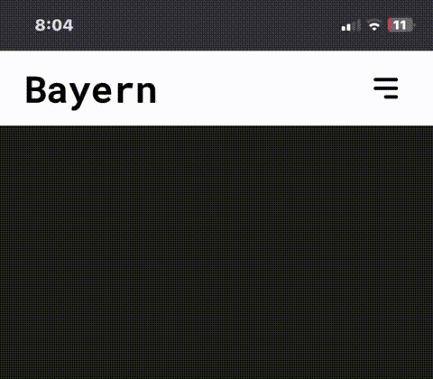

# Bayern — Responsive Navbar



A small practice project: a responsive navigation bar with a working hamburger menu.

Built with plain HTML, CSS, and vanilla JavaScript. No frameworks, no build step.

## Project Structure

```
yt-video
├─ assets
│  ├─ menu.png
│  └─ Video.gif
├─ index.html
├─ LICENSE
├─ README.md
├─ script.js
└─ style.css

```

<h3>Its open source so feel free to use it :) </h3>